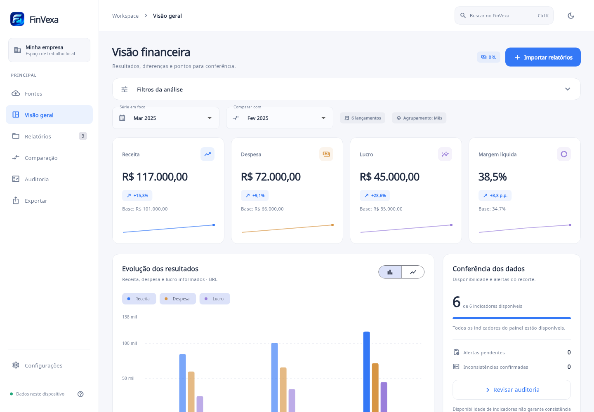
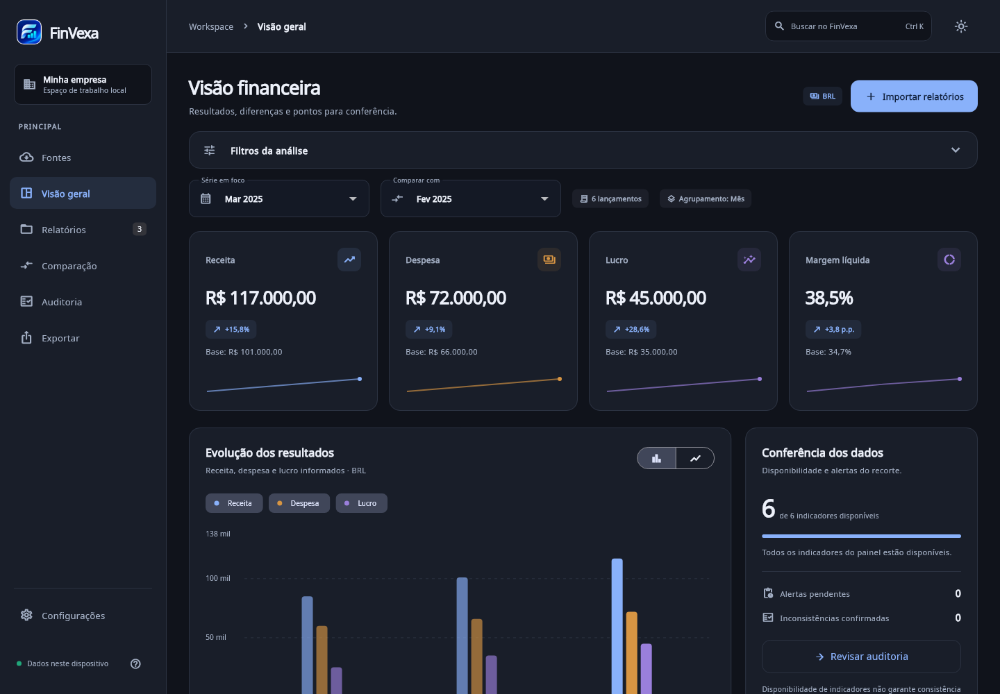
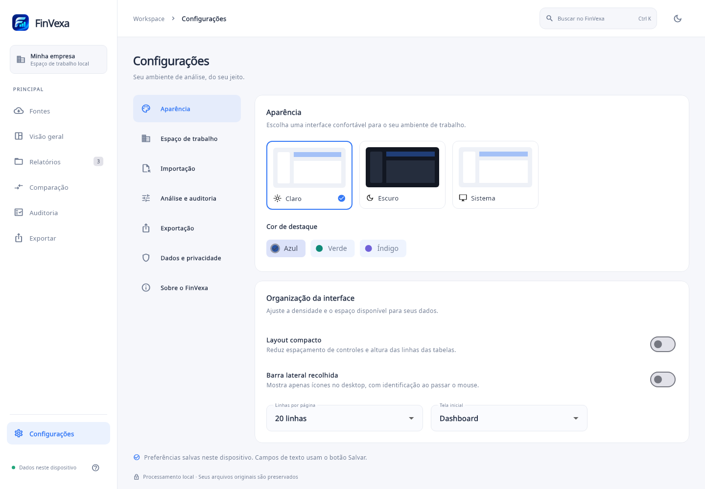
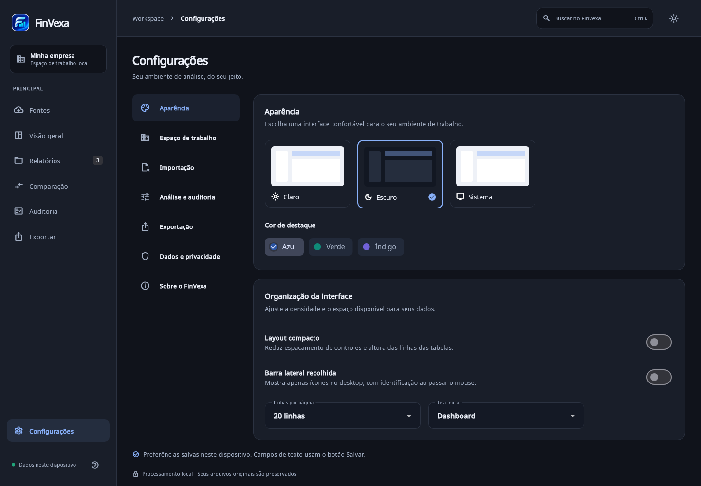

# FinVexa

Aplicativo Flutter para importar, comparar, auditar e exportar relatórios financeiros. Processa os arquivos no dispositivo e persiste relatórios, revisões e histórico em armazenamento local.

## Recursos

- Importação de PDF com texto, XLS/XLSX (BIFF8/OOXML), CSV/TSV, OFX e JSON.
- Conferência obrigatória por tabela: mapeamento de colunas, empresa/período/moeda padrão, separador decimal, edição de células e descarte explícito de linhas inválidas.
- Reconhecimento de cabeçalhos em português/inglês e transformação de colunas de períodos em lançamentos. Planilhas com várias abas são conferidas separadamente; OFX com várias contas mantém contas e moedas separadas.
- Comparação de duas ou mais séries por documento, mês, trimestre, ano ou empresa. Base selecionável, diferenças absolutas/percentuais e destaque de indicadores ausentes.
- Dashboard com barras/linhas, receita, despesa, lucro, caixa, patrimônio e margem líquida, quando esses indicadores são informados.
- Filtros por empresa, conta, categoria, período e moeda; seleção dos documentos incluídos na análise.
- Auditoria baseada em regras: possíveis duplicidades, divergências entre documentos, classificação inconsistente e valores acima de três vezes a mediana da mesma descrição/empresa/conta/moeda (mínimo de quatro ocorrências).
- Revisão de alertas: pendente, confirmado ou descartado, com observações e rastreabilidade por origem/linha. Revisar alertas não altera os valores.
- Exportação PDF e XLSX com gráficos, indicadores, tabelas, observações, lançamentos, auditoria e histórico. CSV organiza o conteúdo em seções de dados, sem gráficos. O usuário pode escolher as seções.
- Histórico guarda filtros, séries, base, notas e uma cópia dos resultados. Toque em um registro para consultá-lo.
- Migração dos relatórios salvos pela primeira versão do aplicativo.

## Capturas de tela

| Tema claro | Tema escuro |
| --- | --- |
|  |  |
|  |  |

## Executar e verificar

```sh
flutter pub get
flutter run -d chrome
flutter analyze --no-pub
flutter test --no-pub
flutter build web --no-pub --no-wasm-dry-run
flutter build windows --no-pub
```

## Formatos de entrada

CSV UTF-8 (também há fallback Latin-1), separado por ponto e vírgula, vírgula ou tabulação:

```csv
descricao;valor;periodo;empresa;conta;categoria;moeda;referencia
Receita líquida;150000,00;2025-01;Empresa A;Operacional;Receita;BRL;DRE-01
Custos;90000,00;2025-01;Empresa A;Operacional;Despesa;BRL;DRE-02
Lucro líquido;60000,00;2025-01;Empresa A;Operacional;Lucro;BRL;DRE-03
```

Descrição e valor precisam de colunas mapeadas. Período e empresa podem vir de uma coluna ou dos padrões definidos na conferência. Datas aceitas: `DD/MM/AAAA`, `MM/AAAA`, `AAAA-MM-DD`, `AAAA-MM`, `AAAA-T1` e `AAAA`. Valores brasileiros: `1.234,56`; americanos: `1,234.56`, escolhendo separador decimal ponto. Células com fórmula no Excel precisam de resultado calculado armazenado no arquivo. Campos adicionais são preservados nos campos de origem e exportados junto aos lançamentos.

JSON de lançamentos:

```json
[{"description":"Receita líquida","amount":150000,"periodo":"2025-01","empresa":"Empresa A","categoria":"Receita","moeda":"BRL"}]
```

Também aceita o formato anterior:

```json
{"name":"DRE 2025","period":"2025","values":{"Receita líquida":150000,"Custos":90000}}
```

Limite: 20 MB por arquivo. Cada aba do Excel e cada conta OFX passa pela conferência. Para cancelar uma tabela, volte da tela de conferência; as outras tabelas ainda serão oferecidas.

## Método e limites

A leitura de PDF é heurística: identifica linhas com descrição seguida de valores e cabeçalhos de períodos. Exige revisão de todas as linhas; layouts complexos podem ser parcialmente reconhecidos. PDFs digitalizados precisam passar por OCR externo antes da importação. PDFs protegidos por senha não têm fluxo de desbloqueio nesta versão.

Categorias ausentes são sugeridas por palavras-chave e podem ser editadas na conferência. Categorias próprias são preservadas; o dashboard tenta relacioná-las pela descrição. OFX sugere créditos como receita e débitos como despesa: revise transferências e estornos.

Não há conversão cambial: cada análise usa uma moeda selecionada. Valores são somados com os sinais originais. Descrições de indicadores são equiparadas por capitalização, acentos e espaços; sinônimos não são reconciliados. Diferença = comparado - base; variação = diferença / valor absoluto da base × 100. Base zero ou valor ausente produz N/D, sem substituir ausência por zero.

Os agrupamentos somam os valores disponíveis; não misture totais e subtotais, nem saldos acumulados e movimentos do período. Lucro, caixa e patrimônio são apresentados apenas quando classificados nos arquivos, sem inferência contábil. Auditoria aponta possibilidades, não conclusões contábeis.

O armazenamento local não oferece login, backup automático nem sincronização. Limpar dados do aplicativo/navegador apaga os dados salvos. Exporte seus relatórios para guardar uma cópia. CSV protege campos textuais contra interpretação como fórmulas; valores numéricos permanecem numéricos no Excel.

## Ícones

A imagem fornecida está em `assets/branding/finvexa.png`. Configuração em `flutter_launcher_icons.yaml`, com `flutter_launcher_icons: ^0.14.4` nas dependências de desenvolvimento.

```sh
dart run flutter_launcher_icons
dart run tool/linux_icon.dart
```

O gerador aplica ícones Android, iOS, web, Windows e macOS. A versão 0.14.4 não gera ícones Linux; o projeto inclui um PNG 512 px, entrada `.desktop` e instalação CMake para essa plataforma. A janela GTK usa o mesmo ícone no bundle.

Os PDFs usam Noto Sans, distribuída sob OFL; licença em `assets/fonts/OFL.txt`.

## Interface desktop e configurações

O aplicativo oferece temas claro, escuro e automático conforme o sistema, com persistência local. A interface desktop usa barra lateral expansível, busca rápida (`Ctrl+K` / `Cmd+K`), filtros recolhíveis, cards de indicadores e tabelas com paginação configurável. Em telas menores, a navegação usa menu lateral e atalhos inferiores.

Em **Configurações**, estão disponíveis:

- **Aparência:** tema, cor de destaque, densidade, barra lateral, linhas por página e tela inicial.
- **Espaço de trabalho:** empresa padrão, responsável, e-mail local de referência e moeda padrão.
- **Importação:** separador decimal, limite por arquivo (5/10/20 MB) e sugestão de categorias.
- **Análise e auditoria:** agrupamento e gráfico iniciais, ativação individual das regras e multiplicador para valores atípicos.
- **Exportação:** título e seções padrão dos relatórios.
- **Dados e privacidade:** resumo do armazenamento, backup JSON, restauração com confirmação, limpeza de histórico e exclusão dos dados financeiros com confirmação.
- **Sobre:** versão, capacidades e método de cálculo.

Aparência, densidade, paginação e regras de auditoria atualizam imediatamente. Padrões de importação valem na próxima importação; agrupamento/gráfico iniciais e conteúdo padrão de exportação são usados ao abrir uma nova sessão. Os campos de texto têm botão Salvar. Preferências não alteram os arquivos já importados nem fazem conversão cambial.

O backup inclui dados estruturados, revisões, resultados históricos e preferências. Não inclui os arquivos originais. A restauração valida o formato e pede confirmação antes de substituir os dados atuais. Informações de responsável e e-mail são locais e incluídas no backup; o aplicativo não envia mensagens.

O teste `desktop_visual_test.dart` renderiza capturas de QA em `.preview/` com fontes reais nos temas claro e escuro. Outros testes verificam persistência das preferências, restauração de backup, limpeza seletiva de histórico e adaptação a desktop baixo, tablet e celular.

## Dashboard financeiro

A visão geral apresenta uma série em foco e uma base escolhida explicitamente. Os quatro indicadores principais (receita, despesa, lucro e margem líquida) mostram os valores da base e suas diferenças. A margem compara pontos percentuais, enquanto os indicadores monetários comparam percentuais sobre o valor absoluto da base. Caixa e patrimônio ficam em uma seção separada.

O gráfico compara receita, despesa e lucro, com seleção dos indicadores, barras/linhas, períodos legíveis e valores completos ao passar o mouse. Ausências não são transformadas em zero nem conectadas por linhas. As pequenas tendências dos cards aparecem apenas nos agrupamentos temporais.

O painel de conferência mostra a disponibilidade de seis indicadores e os alertas pendentes/confirmados. Disponibilidade não equivale a consistência contábil. Os destaques da comparação priorizam ausências e depois as maiores diferenças absolutas, com acesso à comparação completa usando a base selecionada. Os arquivos de origem continuam acessíveis no próprio dashboard.

A barra superior contém busca e alternância de tema. O ícone de conta foi removido; Configurações continua acessível pela navegação lateral ou pelo menu no celular.

## Builds e GitHub Releases

O workflow em `.github/workflows/flutter_build.yml` gera os seguintes pacotes a partir de uma tag correspondente ao `pubspec.yaml`:

| Plataforma | Pacote |
| --- | --- |
| Linux x64 (Ubuntu 24.04 ou distribuição compatível) | `FinVexa-amd64.deb` |
| Android | `FinVexa.apk` |
| Windows x64 | `FinVexa-Setup-x64.exe` (Inno Setup) |
| macOS | `FinVexa-macOS.dmg` |
| iOS | `FinVexa-iOS.ipa` (Ad Hoc) ou `FinVexa-iOS-unsigned.ipa` |

Após enviar o workflow ao GitHub, publique uma tag correspondente a `version:`. Por exemplo, para `version: 1.0.0+1`:

```bash
git tag v1.0.0
git push origin v1.0.0
```

Também é possível selecionar uma tag existente no disparo manual em **Actions**. A publicação exige os cinco pacotes e inclui `SHA256SUMS.txt`. Para repetir o build de uma release já publicada, consulte os artefatos do novo run. A release existente é preservada.

### Assinatura para distribuição

- **Android** — Configure os secrets `ANDROID_KEYSTORE_BASE64`, `ANDROID_STORE_PASSWORD`, `ANDROID_KEY_ALIAS` e `ANDROID_KEY_PASSWORD`. Sem o keystore, o APK usa a chave de depuração do runner. Use o mesmo keystore entre versões para permitir atualizações.
- **iOS** — Configure a variável `IOS_BUNDLE_ID` com o identificador registrado na Apple e os secrets `IOS_CERTIFICATE_BASE64` (arquivo .p12), `IOS_CERTIFICATE_PASSWORD` e `IOS_PROFILE_BASE64` (perfil Ad Hoc). O IPA assinado é instalável nos dispositivos cadastrados no perfil. O IPA sem assinatura é um artefato de build que precisa de assinatura para instalação.
- **Windows e macOS** — O instalador Windows não é assinado e o DMG macOS não é notarizado. O sistema pode exibir avisos de segurança.
